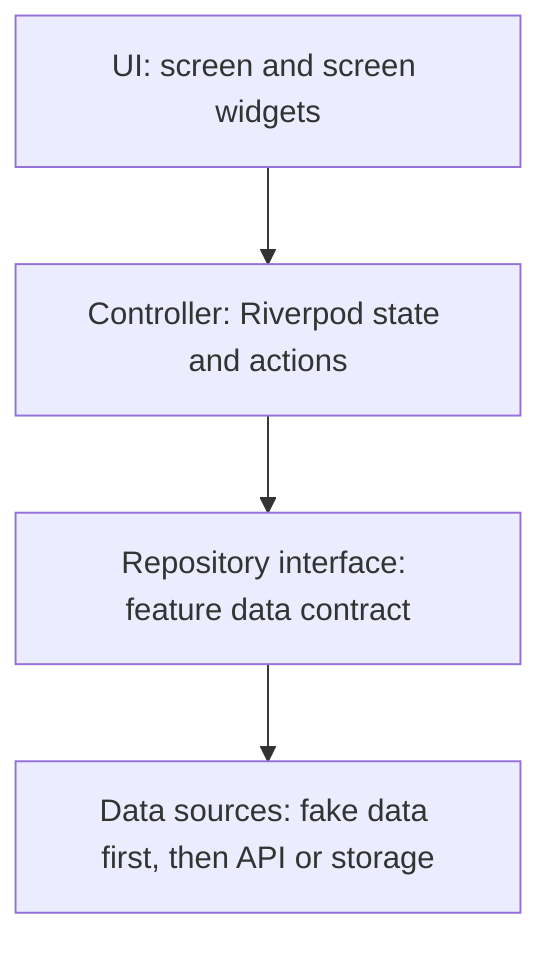

# Mobile app architecture

## State management

Use Riverpod (`flutter_riverpod`) for screen state. Keep state and business logic in a screen's controller; widgets render controller state and send user actions to the controller. The app-wide router and theme remain in `lib/core/`.

## Feature-first structure

```text
lib/
  app/                              # App entry points and debug-only app tooling
  core/
    router/app_router.dart          # The single named-route registry
    theme/                          # Colors, spacing, radii, text styles, icons, themes
    network/                        # API client and network concerns
    storage/                        # Local persistence
  shared/
    widgets/                        # Reusable UI, including AppIcon
  features/
    <feature>/
      repositories/                 # Feature repository interfaces and fake/real sources
      screens/
        <screen>/
          screen.dart
          controller.dart
          widgets/                  # Widgets used only by this screen
```

### Standalone-screen rules

- One screen lives in one `screens/<screen>/` folder. Its screen, controller, and screen-only widgets stay together.
- A screen must never import another screen. Navigate between screens only with named routes registered in `lib/core/router/app_router.dart`.
- Reusable UI belongs in `lib/shared/widgets/`, not in another screen's folder.
- Each screen reads data through a repository interface, normally via its controller. Start with a fake repository implementation; replace or supplement it with API/storage implementations without coupling the screen to those sources.
- Every screen handles loading, empty, error, and offline states. Screens without a meaningful empty result should still define an intentional empty/idle state appropriate to their content.

## Layers



The UI renders state and forwards interactions to the controller. The controller coordinates the repository. The repository abstracts fake data, remote API, and local storage, so screens do not depend directly on transport or persistence details.

## Design and copy

- Read all colors, spacing, radii, and text styles from `lib/core/theme/` tokens. Add a missing reusable token there rather than hardcoding a design value in a screen.
- Define icon glyphs in `AppIcons` (`lib/core/theme/app_icons.dart`) and render them through the shared `AppIcon` widget.
- Use sentence case for all user-facing text.
- Use the screenshots in `docs/reference/web/` as the source of truth for screen layout, wording, structure, and behavior. Use Figma only for exact design tokens where it does not conflict with a screenshot. Record any conflict in `docs/SCREENS.md`.

## Debug screen gallery

Expose a screen gallery only in debug builds, at a debug-only named route. It lists every screen by name and opens each through its named route. Do not include the gallery route in release builds.
